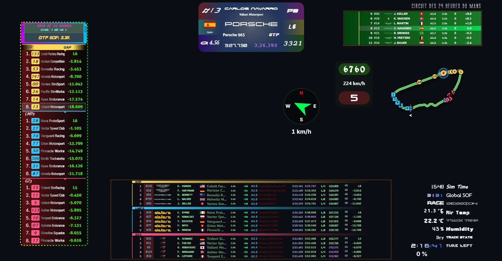

# iPitWall

**Telemetry overlays for iRacing.** Compose your widgets in an editor, see them live on top of the
game, and send the same layout to OBS.



*Screenshot taken with the built-in demo data: every driver and team shown is fictitious.*

> **Alpha.** iPitWall is in early testing. Things may break; please [report them](#report-a-problem).

## Download

**[Get the latest installer from the Releases page](https://github.com/RonnyVergara/iPitWall/releases)**
— download `iPitWall-Setup-<version>.exe` and run it. Windows, 64-bit.

The installer is **not code-signed yet**, so Windows SmartScreen may warn you: choose
*More info → Run anyway*. Each release ships a `SHA256SUMS.txt` file to check your download.

**Updates are automatic.** iPitWall looks for a new version shortly after it starts, downloads it in
the background, then asks you: *Restart to Update* now, or *Later* (it installs when you close the
app). You can also use *Help → Check for Updates…*

## Getting started

1. In iRacing, run the game **in windowed mode (borderless)**. No overlay can appear above exclusive
   full screen.
2. Open iPitWall. The editor shows your screens.
3. In the **Assets** tab, click or drag a widget onto your screen.
4. Check that the **Overlay** button is on, and pick the screens with the numbered buttons next to it.
5. No iRacing running? Press **Demo** to set up your widgets with sample data.

## What you get

**69 widgets**, all adjustable in the editor:

| Family | Includes |
|---|---|
| Standings | general, relative and TV leaderboards |
| Car | speed, gear, RPM, pedals, steering, fuel level and **fuel calculator**, brake bias, tires, ABS, traction control, temperatures… |
| Timing | positions, current / last / best / predicted lap, gap to session best, time remaining, incidents |
| Driver & team | name, team, car, country, iRating, license |
| Session | strength of field, track, series, flags, **incident timeline**, **track map**, camera and replay controls |
| Weather | air and track temperature, humidity, wind, precipitation, track state |
| Static | your own images |

- **Editor:** layers, groups, snapping and guides, per-widget fonts, colours, gradients and effects.
- **Layouts and boards:** keep several layouts, import and export them, and save a group of widgets
  as a board to reuse it.
- **Replays:** play back a telemetry file (`.ibt`) with pause, seek and speed. Files saved by iRacing
  contain only your own car, so multi-car widgets stay mostly empty with them.
- **Fuel auto-fill:** the fuel calculator can set the fuel in your pit menu when you enter the pit
  lane (live sessions only).

## The overlay

- One transparent window on each selected screen that has a widget: always on top, **clicks go
  through it**, and it never takes your keyboard. Outside a session it shows nothing.
- *Overlay → Show Overlay* turns it on or off (`Ctrl+Shift+O` while iPitWall is focused).
- *Overlay → Hide When Out of Car* (off by default) hides it whenever you are not in your car,
  **replays included**. Leave it off if you want your widgets on screen while watching or streaming
  replays.
- It steps aside on the screen where you are working in iPitWall, and comes back when you switch to
  the game.

## OBS

Add a **Browser source** at 1920 × 1080 with this address (also available through
*Overlay → Copy OBS Source URL*):

```
http://127.0.0.1:32182/?surface=obs
```

iPitWall must be running. The OBS source is never hidden by *Hide When Out of Car*.

## Report a problem

1. In iPitWall, choose **Help → Export Diagnostic Report…** It saves a ZIP with the logs and crash
   reports; your layouts and personal settings are not included. Crash reports stay on your PC
   unless you share them.
2. [Open an issue](https://github.com/RonnyVergara/iPitWall/issues): what you did, what you expected,
   what happened. Attach the ZIP if you can.

---

This repository hosts the releases and the issue tracker; the source code is private.
iPitWall is not affiliated with or endorsed by iRacing.com. All trademarks belong to their owners.
